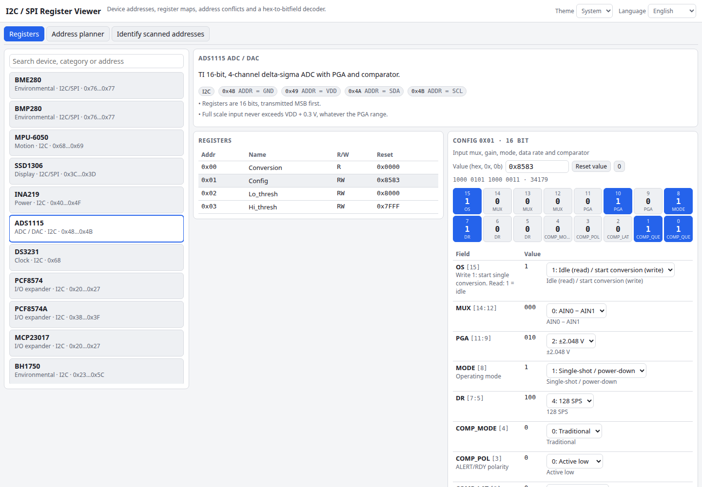

# I2C / SPI Register Viewer

A built-in database of common I2C and SPI parts with their addresses and register maps, plus three tools on top of it: a hex-to-bitfield decoder, an I2C address conflict finder and an identifier for the addresses an I2C scanner reports. It covers the BME280/BMP280, MPU-6050, SSD1306, INA219, ADS1115, DS3231, MCP23017, PCF8574, BH1750, TMP102, LM75A, LIS3DH, ADXL345, PCA9685, W25Q32 flash and more.

**Try it: [hermes98761234.github.io/i2c-spi-register-viewer](https://hermes98761234.github.io/i2c-spi-register-viewer/)**

[](https://github.com/hermes98761234/i2c-spi-register-viewer/actions/workflows/deploy.yml)



## Features

- **Register maps** with reset values, access type and a description for every register, searchable by device, category or address.
- **Bitfield decoder**: type `0x8583`, `8583`, `0b1000...` or click individual bits. Every field shows its bits and what the value means (`PGA = 2 → ±2.048 V`); edit a field through its drop-down to build a register value.
- **Address planner**: add the parts on your bus (the same part can appear several times) and get a conflict-free address assignment with the pin strapping that selects each address, a 128-cell address map and a clear message when a clash is unavoidable.
- **Scanner identifier**: paste `i2cdetect` output and see which parts could answer at each address, flagging ambiguous ones such as 0x68 (MPU-6050 or DS3231).
- **Shareable**: the selected device, register and value are in the URL hash.
- English and Ukrainian UI (register names and descriptions stay in English), light/dark/system theme. Nothing leaves your browser.

## How it works

Each device is a typed record: bus types, selectable addresses, registers with their bitfields and value tables. The decoder extracts a field as `(value >> lsb) & mask`. The planner is a branch-and-bound search that minimises the number of clashing pairs and then prefers each part's default address. Unit tests check known reset values (ADS1115 0x8583, INA219 0x399F, MPU-6050 0x40), the decoding of typical configuration bytes, field-overlap and range consistency of the whole database, and well-known address collisions.

The register data is hand-entered from public datasheets; if you spot a mistake, please open an issue.

## Quick start

You need [Node.js](https://nodejs.org/) 22.

```bash
git clone https://github.com/hermes98761234/i2c-spi-register-viewer.git
cd i2c-spi-register-viewer
npm install
npm run dev       # http://localhost:5173
npm test          # decoder, database consistency and planner tests
npm run build     # static site in dist/
```

## License

MIT
